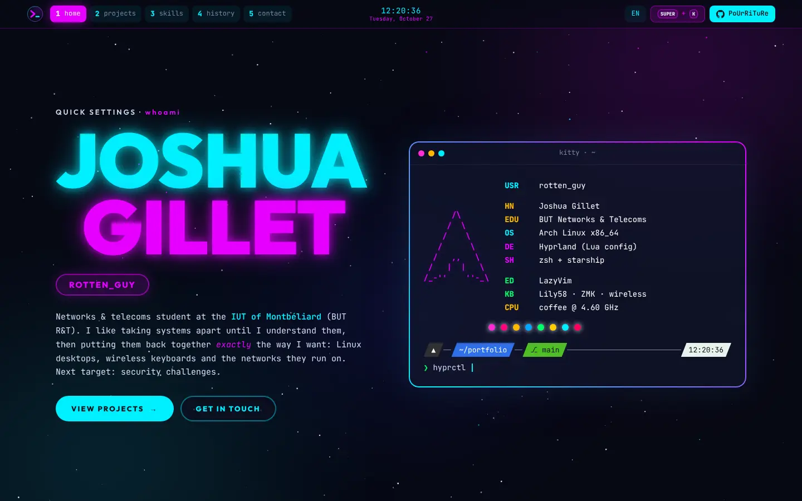

<div align="center">

# 🌌 rotten_portfolio

**A neon cyan / magenta portfolio, set against a nebula.**

*Plain HTML · CSS · JS · no framework, no build step · GitHub Pages*

**[rotten-guy.github.io](https://rotten-guy.github.io)**

</div>

---



---

## ✨ Features

| | Component | Details |
|---|---|---|
| 🖥️ | **Serpantinum-style top bar** | Sections are workspaces `1 … 5`: click them or press the number keys; the active one lights up magenta. Live clock in the center, like the real bar |
| 🔐 | **Greeter-style hero** | The name is drawn like the `nebula` SDDM clock: cyan line, magenta line, neon glow, a flicker now and then |
| 🐱 | **kitty + fastfetch card** | Arch logo in magenta, colored keys, palette dots and a starship prompt that types real commands |
| 🌈 | **Animated borders** | The Hyprland border: cyan → magenta gradient rotating at a constant speed, fading in when a card gets focus or the mouse |
| ⌨️ | **`SUPER + K` menu** | Press `K` anywhere: a fuzzel-like menu to jump to a section, a project or a link (`↑ ↓`, `Enter`, `Esc`) |
| 🗂️ | **Project windows** | Each project is a window with a screenshot gallery (tabs + lightbox), features, stats and tags |
| 📈 | **Live training** | Root-Me and typing stats (keybr + Monkeytype) read from `training.json` in the [profile repository](https://github.com/rotten-guy/rotten-guy), redrawn every night: a Lily58 that loops over three phrases (`i use arch btw`, `sudo pacman -Syu`, `ping -c 1 8.8.8.8`) at my real speed (or whatever the visitor types), and a typing calendar with the minutes of each day on hover / click |
| 🧩 | **Keycap skills** | Skills are drawn like the shortcut cheatsheet keys; typing a letter presses the matching keycaps |
| 🌌 | **Starfield** | Twinkling stars on a canvas, with a few cyan and magenta ones, over slowly drifting nebula clouds |
| 📜 | **`git log` history** | Timeline with real commit hashes from the projects |
| 📱 | **Responsive** | Works from 320 px wide. When the device asks for less motion (`prefers-reduced-motion`), a calm mode stops the flicker, the drifting nebula and the fly-ins but keeps the typing; `SUPER + K` → *animations* switches modes (remembered in the browser) |
| 🚫 | **404 page** | `hyprctl dispatch workspace 404` |

---

## 🗂️ Projects shown

| Project | Kind | Stack |
|---|---|---|
| [**rotten_dotfiles**](https://github.com/rotten-guy/dotfiles) | Personal | Arch Linux, Hyprland (Lua), Bash, Python, QML, systemd, PAM, PipeWire |
| [**rotten Lily58**](https://github.com/rotten-guy/rotten_lily58_keymap_config) | Personal | C, Zephyr RTOS, ZMK, Devicetree, Python, GitHub Actions |
| Write-ups | Personal | ZMK dongle, IKEv2 VPN, tablet as a monitor, Arch notes (in the dotfiles `docs/`) |
| Training | Live | [Root-Me](https://www.root-me.org/rotten-guy?lang=en) (security challenges) · typing on [keybr](https://www.keybr.com/profile/752ae7r) and [Monkeytype](https://monkeytype.com/profile/rotten_guy) |

---

## 🔣 Logos

The site's logo is **`>_`** (favicon, nav bar, 404); the personal logo **rotten / guy>_** sits on the contact card. Both are drawn by `scripts/make-logo.py` in the [profile repository](https://github.com/rotten-guy/rotten-guy) and copied here.

---

## 🎨 Palette

Same colors as the rice (see `assets/cheatsheet.html` in the dotfiles):

| Token | Value | Used for |
|---|---|---|
| `--bg` | `#070914` | Background |
| `--cyan` | `#00f0ff` | Primary accent, links, keycaps |
| `--magenta` | `#e600ff` | Secondary accent, active workspace, link tables |
| `--text` | `#d6def5` | Body text |
| `--dim` | `#7d86a8` | Secondary text |
| `--card` | `rgba(18, 22, 46, .72)` | Translucent windows (blurred, like Hyprland) |

Fonts: **JetBrains Mono** (everything) and **Outfit** (neon titles, close to the greeter font), from Google Fonts.

---

## 📁 Repository layout

```
rotten-guy.github.io/
├── index.html                  # the whole site, one page, 5 "workspaces"
├── style.css                   # Nebula theme
├── script.js                   # starfield, clock, workspaces, SUPER + K menu, galleries
├── 404.html
├── .nojekyll                   # serve files as they are, no Jekyll
└── assets/
    ├── icons/                  # ">_" site logo: favicon.svg, apple-touch-icon.png, icon-512.png
    └── img/                    # screenshots (webp), keymap SVGs, screens GIF, avatar.svg, preview + og image
```

---

## 🚀 Running locally

No build step: open `index.html`, or serve the folder so absolute paths in `404.html` work:

```bash
python3 -m http.server 8000
# → http://localhost:8000
```

## 🌐 Deploying

GitHub Pages serves the `main` branch root: *Settings* → *Pages* → *Deploy from a branch* → `main` / `/ (root)`. Every push to `main` is online a minute later at **https://rotten-guy.github.io**.

---

## 🔧 Editing

- **A project**: copy one `<article class="project win">` block in `index.html`. Gallery tabs take `data-src` / `data-alt`; the first tab must match the `` below it.
- **Screenshots**: convert to WebP, ~1600 px wide (`convert in.png -resize 1600x -quality 82 out.webp`), into `assets/img/`.
- **Lily58 demo phrases**: the `PHRASES` list in `script.js` (and in `scripts/make-training.py` of the profile repository, for the GitHub animation).
- **Training**: numbers come from `training.json` (profile repository, `scripts/make-training.py`); the cards, the Lily58 demo and the typing log are filled by the last block of `script.js`. If the file cannot be loaded, the demo and the log hide themselves.
- **`SUPER + K` entries**: the `items` list in `script.js`.
- **Skills**: `<span class="key">` (cyan) or `<span class="key super">` (magenta = daily use).
- **History**: `<li>` entries of `.log` in `index.html` (`merge` = magenta dot, `root` = yellow dot, `next` = dashed green dot for what is in progress).
- **Preview images**: `assets/img/preview.webp` (1440 × 900) and `assets/img/og.png` (1200 × 630, link previews) are screenshots of the hero; retake them after a visual change.

---

## 🗺️ Later

- [ ] Look at [tessdev.fr](https://tessdev.fr/) and its older version ([git.tessdev.fr/karma/portfolio](https://git.tessdev.fr/karma/portfolio.git)) for ideas (both hosts must be allowed in the Claude session's network settings first)

---

## 🙏 Credits

- Screenshots and keymap pictures from [rotten_dotfiles](https://github.com/rotten-guy/dotfiles).
- Fonts: [JetBrains Mono](https://www.jetbrains.com/lp/mono/) and [Outfit](https://fonts.google.com/specimen/Outfit) (SIL Open Font License).
- Built with the help of **[Claude](https://claude.ai)** (Anthropic), like the rice it shows off.
